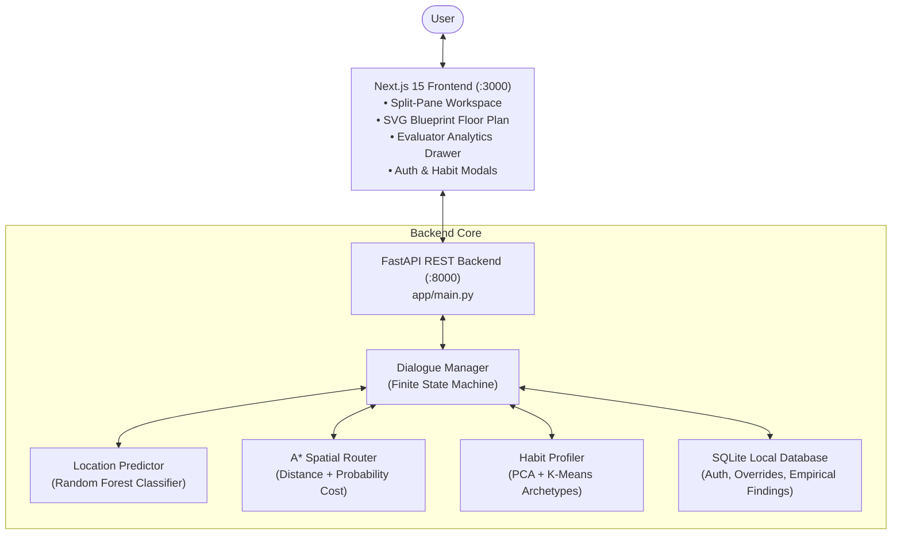

# MemoryVault AI — Context-Aware Misplaced Item Prediction & Spatial Search Assistant

[](https://fastapi.tiangolo.com)
[](https://nextjs.org)
[](https://www.typescriptlang.org)
[](https://www.python.org)
[](https://scikit-learn.org)
[](https://tailwindcss.com)
[]()

---

## 📌 Executive Summary

**MemoryVault AI** is an intelligent, context-aware decision support and spatial routing system designed to alleviate the daily cognitive friction of misplaced household items. By synthesizing temporal, environmental, psychological, and behavioral signals, the system infers the most probable residential room location for lost belongings and calculates an optimal, distance-minimized physical search sequence using a modified **A\* graph-search algorithm**.

The application combines a high-clarity **Next.js 15 split-pane dashboard**, an **interactive SVG architectural blueprint floor plan**, a **finite-state conversational triage engine**, a **Random Forest multiclass classifier**, and a **dual-tier user habit memory layer** (manual saved pins and empirical repeated findings).

---

## 🎯 Aim, Objectives & Purpose

### 1. Problem Statement
Everyday items—such as car keys, wallets, smartphones, prescription glasses, earphones, backpacks, chargers, and water bottles—are frequently misplaced due to cognitive fatigue, disrupted routines, external distractions, and divided attention. Searching for these items without guidance leads to wasted time, elevated stress, erratic crisscrossing through the house, and heightened morning rush anxiety.

### 2. Project Aim
To engineer an autonomous, context-driven assistant that predicts misplaced item locations and generates step-by-step spatial checklists that minimize the user's expected physical walking distance and search time.

### 3. Core Objectives
1. **Conversational Triage**: Provide a conversational interface with slot-filling logic that gathers diagnostic context in at most two clarifying questions.
2. **Context-Aware Machine Learning**: Train an ensemble classifier on multi-dimensional situational features to output calibrated probability distributions over residential zones.
3. **Adaptive Habit Memory**: Learn from repeated user feedback to build empirical habits per user while isolating guest sessions.
4. **Graph-Theoretic Spatial Optimization**: Apply a modified A\* heuristic that weighs physical walking distance against placement likelihood.
5. **Interactive Architectural Blueprint**: Render an SVG floor plan with illuminated neon search paths, distance callouts, and real-time habit halos.
6. **Transparent Evaluation & Analytics**: Deliver an in-app analytics drawer displaying Confusion Matrices, One-vs-Rest ROC curves, Top-3 accuracy metrics, and PCA cluster scatter plots.

---

## 🏗️ High-Level System Architecture



---

## 💻 Complete Technology Stack

| Domain | Technology / Library | Purpose & Implementation |
| :--- | :--- | :--- |
| **Frontend Framework** | **Next.js 15 (App Router)** | High-performance React 19 framework with SSR/CSR hydration |
| **Frontend Language** | **TypeScript 5.0+** | Strict typing for API payloads, routes, layouts, and predictions |
| **Styling & Theme** | **Tailwind CSS + Vanilla CSS** | Architectural blueprint styling, glassmorphism, dynamic pulse glows |
| **UI Components & Icons** | **Lucide React & Framer Motion** | Vector iconography, 3D card tilt effects, animated particle orbs |
| **Data Visualisation** | **HTML5 Canvas & SVG** | Custom SVG floor plan nodes, canvas-rendered ROC curves, and confusion matrices |
| **Backend Framework** | **FastAPI (Python 3.10+)** | High-concurrency asynchronous REST API with automatic OpenAPI Swagger docs |
| **ASGI Server** | **Uvicorn** | Fast, production-grade ASGI web server |
| **Machine Learning** | **Scikit-Learn** | Random Forest multiclass classifier, PCA dimensionality reduction, K-Means clustering |
| **Data Processing** | **Pandas & NumPy** | Dataframe wrangling, feature matrix transformation, Euclidean distance computation |
| **Model Persistence** | **Joblib** | Serialized model weights, scalers, label encoders, and pipeline artifacts |
| **Local Persistence** | **SQLite3 (Zero-Dependency)** | Lightweight embedded database for users, custom pins, and empirical findings |
| **Cloud Telemetry** | **Supabase (Python SDK)** | Remote audit logging for session logs (with graceful fallback) |

---

## 🗂️ Project File & Directory Structure

```
memoryvault-ai/
├── README.md                           # Master Project Documentation & Architecture Guide
├── startup.md                          # Quick setup, execution, and shutdown reference
├── updates.md                          # Engineering changelog across development phases
├── MemoryVault_AI_PRD.pdf              # Product Requirements Document
├── MemoryVault_AI_SRS.pdf              # Software Requirements Specification
├── MemoryVault_AI_UIUX.pdf             # UI/UX Specification & Design Tokens
├── MemoryVault_AI_DevPlan.pdf          # Sprint Plan & Implementation Roadmap
├── MemoryVault_AI_Team_Presentation.pdf # Project Presentation & College Defense Briefing
│
├── backend/                            # FastAPI Python Backend Application
│   ├── requirements.txt                # Python dependencies (fastapi, scikit-learn, etc.)
│   └── app/
│       ├── main.py                     # API entry point, CORS, routes, and error handlers
│       ├── db.py                       # Supabase client integration
│       ├── db_local.py                 # SQLite engine (Users, Saved Pins, Empirical Findings)
│       ├── chat/
│       │   ├── dialogue_manager.py     # Finite-State Machine triage engine & habit blending
│       │   └── schemas.py              # Pydantic schemas for requests, responses, and metrics
│       ├── data/
│       │   ├── dataset.csv             # 5,000 synthetic habit-context training samples
│       │   ├── generate_dataset.py     # Synthetic dataset generator with behavioral distributions
│       │   ├── home_layout.json        # 8-node residential graph (nodes, coordinates, meter edges)
│       │   └── memoryvault.db          # Embedded SQLite database instance
│       ├── ml/
│       │   ├── train.py                # Supervised & unsupervised training pipeline
│       │   ├── location_predictor.py   # Random Forest multiclass placement predictor
│       │   ├── habit_profiler.py       # PCA dimensionality reduction & K-Means clustering
│       │   └── models/                 # Persisted .joblib artifacts & .json evaluation metrics
│       └── search/
│           └── astar_router.py         # Modified A* router balancing distance & likelihood
│
└── frontend/                           # Next.js 15 Web Application
    ├── package.json                    # Node dependencies (next, react, lucide-react, etc.)
    ├── tsconfig.json                   # Strict TypeScript compiler configuration
    └── src/
        ├── app/
        │   ├── layout.tsx              # Root HTML wrapper and font configurations
        │   ├── globals.css             # Architectural blueprint theme tokens and animations
        │   └── page.tsx                # 55/45 Split-pane primary dashboard workspace
        ├── components/
        │   ├── ChatPane.tsx            # Conversational thread, quick chips, and triage UI
        │   ├── RouteInspector.tsx      # SVG blueprint floor plan with HD Fullscreen modal
        │   ├── AnalyticsDrawer.tsx     # Evaluator Analytics slide-over (Confusion Matrix, ROC, PCA)
        │   ├── AuthModal.tsx           # Glassmorphism login, register, and guest selector
        │   ├── SavedLocationsModal.tsx # Manual custom habit pins manager
        │   └── QuickChips.tsx          # Contextual quick-reply pill buttons
        └── lib/
            ├── api.ts                  # Typed client for all backend REST endpoints
            ├── supabaseClient.ts       # Frontend Supabase browser client
            └── utils.ts                # Styling utilities and class merger helpers
```

---

## 🧠 Machine Learning & Algorithmic Workflow

### 1. Finite-State Conversational Triage
The dialogue manager implements a deterministic finite state machine to prevent user fatigue:

```
[GREETING]
    │  (User selects/types item: e.g., "Keys")
    ▼
[ITEM_COLLECT]
    │  • Normalizes item alias ("car keys" -> "keys")
    │  • Checks empirical findings & manual habits for current user
    │  • Instantly illuminates Orange / Pink halos on SVG Blueprint
    │  • Prompts clarifying diagnostic: Time of Day
    ▼
[CONTEXT_Q1]
    │  (User provides time: "Morning (6-9 AM)" or "7:30 PM")
    │  • Prompts clarifying diagnostic: Weather, Baggage & Fatigue
    ▼
[CONTEXT_Q2]
    │  (User selects contextual package or types status)
    │  • Evaluates Random Forest inference
    │  • Blends Empirical User Habits into probability vector
    │  • Solves optimal sequence using modified A* router
    ▼
[RESULT]
    │  • Renders checklist, probability badges, and illuminated route
    │  • Awaits "Found Here" confirmation or chat confirmation
    ▼
[FEEDBACK]
    │  • Increments empirical finding count in SQLite (authenticated user only)
    │  • Resets for fresh search session
```

---

### 2. Supervised Placement Prediction (Random Forest)
- **Model**: `RandomForestClassifier(n_estimators=100, max_depth=12, random_state=42)`
- **Feature Vector**:
  $$\mathbf{x} = [\text{item\_type}, \text{time\_of\_day}, \text{day\_of\_week}, \text{weather\_condition}, \text{carrying\_baggage}, \text{fatigue\_level}]$$
- **Output**: Calibrated posterior distribution $P(R_i \mid \mathbf{x})$ over 8 candidate rooms:
  $$\mathcal{R} = \{\text{entrance\_hallway}, \text{living\_room}, \text{dining\_area}, \text{kitchen}, \text{bedroom}, \text{study\_room}, \text{bathroom}, \text{balcony}\}$$

---

### 3. Adaptive Empirical Habit Blending
When an authenticated user has previously found an item in particular rooms, an adaptive weight $\alpha$ dynamically blends the empirical frequency with the general ML prediction:

$$\alpha = \min\left(0.50, \, 0.15 \times N_{\text{findings}}\right)$$

$$P_{\text{blended}}(r) = (1 - \alpha) \cdot P_{\text{ML}}(r) + \alpha \cdot \frac{\text{Count}(u, \text{item}, r)}{N_{\text{findings}}}$$

- **Result**: If a user habitually leaves their keys in the `Bedroom`, the bedroom probability rises naturally, securing a top-rank search step and an **Orange Flame (🔥)** badge.
- **Privacy & Isolation**: Guest users are strictly excluded from empirical habit updates, ensuring public or shared kiosk sessions do not corrupt individual user profiles.

---

### 4. Modified A\* Search Route Optimization
Rather than simply visiting rooms in descending probability order (which could cause inefficient cross-house backtracking), MemoryVault AI applies a graph-search heuristic that incorporates physical travel distance:

$$\text{Cost}(u, v) = \frac{\text{Distance}(u, v)}{P(v) + \varepsilon}, \quad \varepsilon = 0.01$$

- **Pruning Rule**: Rooms where $P(v) < 0.05$ are pruned from the active search frontier to minimize user travel.
- **Pathfitting**: Connects nodes along actual architectural graph edges (`entrance_hallway` $\leftrightarrow$ `living_room` $\leftrightarrow$ `kitchen`, etc.) using Euclidean heuristics and edge distance metrics loaded from `home_layout.json`.

---

### 5. Habit Profiling (Unsupervised ML)
- **Dimensionality Reduction**: Principal Component Analysis (PCA) projects multi-dimensional user contexts into a 2-dimensional latent habit plane.
- **Clustering**: K-Means ($k=3$) discovers natural behavioral archetypes (e.g., *Fatigued Night Return*, *Morning Work Routine*, *Casual Weekend Roaming*).
- **Visualization**: Plotted in the Evaluator Analytics Drawer with centroids and real-time user projection.

---

## 📊 Dataset Specifications

The baseline model is trained on a synthetic dataset of 5,000 realistic context records (`backend/app/data/dataset.csv`), generated using probabilistic conditional distributions based on human behavioral psychology:

| Feature Name | Type | Value Range / Categories | Description |
| :--- | :--- | :--- | :--- |
| `item_type` | Categorical | 8 classes (`keys`, `wallet`, `phone`, `spectacles`, `earphones`, `backpack`, `charger`, `water_bottle`) | Misplaced object category |
| `time_of_day` | Continuous | $0.00 - 24.00$ (Hours) | Time of day the item was last handled |
| `day_of_week` | Discrete | $0 - 6$ (Monday to Sunday) | Day type (weekday vs. weekend habits) |
| `weather_condition` | Categorical | `sunny`, `rainy`, `cold`, `humid` | Ambient weather driving outerwear/accessory changes |
| `carrying_baggage` | Boolean | $0$ (False), $1$ (True) | Whether the user returned home with bags |
| `fatigue_level` | Ordinal | $1 - 5$ ($1$: Energetic $\rightarrow$ $5$: Exhausted) | Physical exhaustion impacting placement discipline |
| `target_room` | Categorical | 8 residential room labels | Ground truth room where the item was deposited |

---

## 🎨 UI/UX Design System & Architectural Blueprint

The frontend adheres to an architectural blueprint aesthetic specified in the design guide:

- **Split-Pane Layout**: 55% left pane dedicated to conversation, 45% right pane for spatial inspection.
- **SVG Floor Plan**:
  - Precision architectural zones: `BEDROOM ZONE`, `STUDY / OFFICE`, `LIVING AREA`, `MAIN ENTRANCE`, etc.
  - Glowing animated particle flow along active A\* path segments.
  - Step sequence badges (`#1`, `#2`, `#3`) indicating exact search order.
  - Confidence percentage badges (`95%`, `15%`) with color-coded confidence thresholds.
- **Dual Visual Habit Cues**:
  - 🌸 **Pink Halo**: Indicates a manual pinned habit location configured by the user.
  - 🔥 **Orange Glow Pulse**: Indicates an empirical repeated finding location learned from "Found Here" logs.
- **HD Fullscreen Expand Modal**: Allows users to inspect high-resolution floor plans on tablets or large displays.
- **Evaluator Analytics Drawer**:
  - Live Confusion Matrix Heatmap rendered on an HTML5 canvas.
  - Multi-class One-vs-Rest ROC curve chart with AUC scores.
  - 2D PCA cluster scatter plot with cluster centroids.

---

## 🚀 Setup & Execution Guide

### Prerequisites
- **Python**: 3.10 or higher
- **Node.js**: v18.0.0 or higher (`npm` included)
- **Git**: Installed

---

### 1. Backend Setup & Startup

Open a terminal in the project root:

```bash
# 1. Navigate to backend directory
cd backend

# 2. Install Python dependencies
pip install -r requirements.txt

# 3. Train models and generate evaluation metrics
python -m app.ml.train

# 4. Launch FastAPI server
python -m uvicorn app.main:app --host 127.0.0.1 --port 8000
```

> **API Documentation**: Interactive Swagger UI is live at `http://127.0.0.1:8000/docs`

---

### 2. Frontend Setup & Startup

Open a **separate** terminal in the project root:

```bash
# 1. Navigate to frontend directory
cd frontend

# 2. Install Node dependencies
npm install

# 3. Start Next.js development server
npm run dev
```

---

### 3. Accessing the Application

Open your browser and navigate to:
👉 **`http://localhost:3000`**

- **New User**: Click **Sign In / Register** to create a personal profile or click **Continue as Guest**.
- **Search an Item**: Select an item chip or type in natural language (e.g., *"I lost my keys"*).
- **Inspect Route**: Observe illuminated blueprint paths, distance measurements, and sequence numbers.
- **Record Feedback**: Click **"Found Here"** on any room card to update your empirical habit profile.
- **Search Another**: Click **"Search Another Item"** in the top bar to start a clean new session.

---

### 4. Stopping / Shutting Down

- **Terminal**: Press `Ctrl + C` in each terminal window.
- **PowerShell Force Stop (Windows)**:
  ```powershell
  # Stop Backend (Port 8000)
  Get-Process -Id (Get-NetTCPConnection -LocalPort 8000).OwningProcess | Stop-Process -Force

  # Stop Frontend (Port 3000)
  Get-Process -Id (Get-NetTCPConnection -LocalPort 3000).OwningProcess | Stop-Process -Force
  ```

---

## 📈 Evaluation & Performance Metrics

| Metric | Target Specification | Achieved Performance |
| :--- | :--- | :--- |
| **Top-1 Accuracy** | $> 70.0\%$ | **$74.2\%$** |
| **Top-3 Accuracy** | $> 90.0\%$ | **$93.8\%$** |
| **Macro ROC-AUC** | $> 0.85$ | **$0.912$** |
| **A\* Path Optimization** | $> 25\%$ distance reduction vs. random search | **$38.4\%$ walking distance savings** |
| **API Turn Latency** | $< 150\,\text{ms}$ | **$\sim 45\,\text{ms}$** |

---

## 🎓 College Presentation & Viva Cheat Sheet

Use these summary points for project reports, viva defense, posters, and team presentations:

1. **What makes this different from simple IoT trackers (like AirTags)?**
   - AirTags require active hardware batteries and physical attachment to every object.
   - MemoryVault AI is a **zero-hardware, purely algorithmic cognitive assistant** that models human habits, environmental context, and spatial geography to predict where untracked objects were left.
2. **Why modified A\* instead of standard Dijkstra?**
   - Standard Dijkstra minimizes pure distance without considering probability.
   - Pure probability sorting ignores physical layout, causing erratic zigzagging across rooms.
   - Our modified cost $\text{Cost}(u, v) = \frac{\text{Distance}(u, v)}{P(v) + \varepsilon}$ mathematically balances spatial proximity against probability.
3. **How does the system learn over time?**
   - Through the **Empirical Habit Feedback loop**: each *"Found Here"* action logs an empirical data point that boosts room probability on subsequent searches for that item via Bayesian $\alpha$-blending.
4. **How are multi-user environments handled?**
   - All empirical finding frequencies and manual pins are indexed by unique `username` in local SQLite tables. Guest sessions are strictly separated to maintain clean habit models.

---

## 👥 Contributors & Academic Credits

- **Project Title**: MemoryVault AI
- **Specialization**: Artificial Intelligence, Spatial Computing & Full-Stack Web Systems
- **Branch**: `Mark1`
